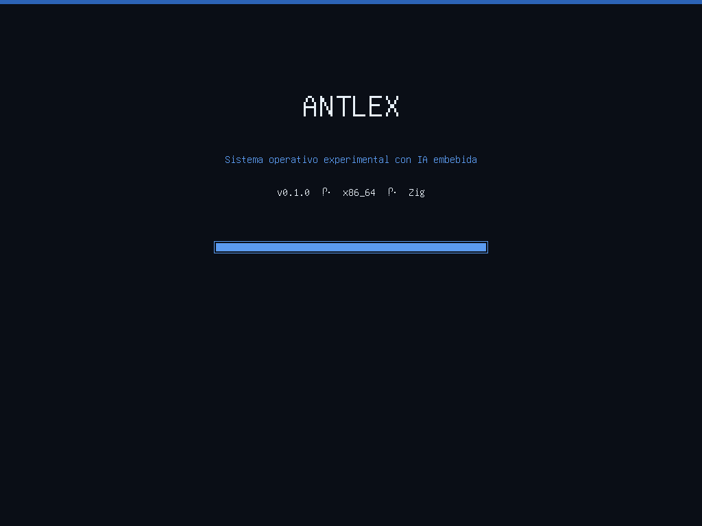
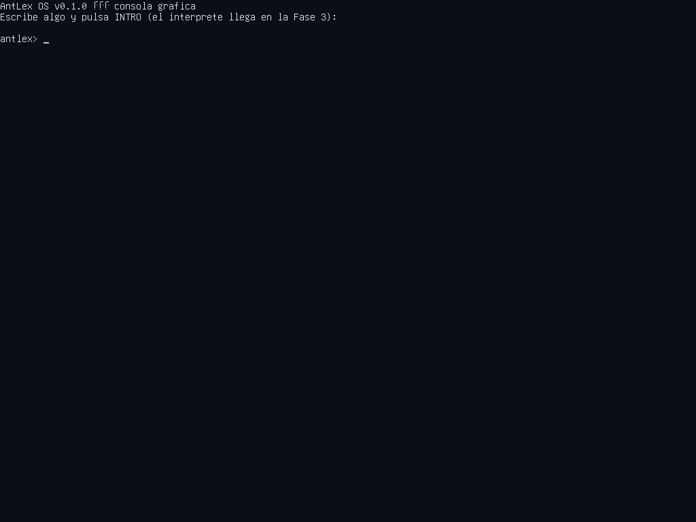

# AntLex OS

**Sistema operativo experimental desde cero en Zig (x86_64) con IA embebida, GUI propia y sistema de archivos propio.**

- **Bootloader 100% propio** (BIOS con MBR + stage2 en ensamblador; UEFI en camino) — ni GRUB ni Limine
- **Gráfico desde el primer instante**: el stage2 activa VBE 1024×768×32 antes de saltar al kernel
- **Kernel en Zig** sin librería C ni runtime: GDT/IDT propias, PIC, PIT, teclado PS/2 (ES/US), framebuffer, consola gráfica
- **IA embebida (LEX)**: red neuronal diminuta entrenada en build-time que solo sabe del propio sistema (Fase 4)
- **ALFS (AntLex File System)**: sistema de archivos propio con persistencia real (Fase 2)
- **Escritorio dividido**: terminal a la izquierda, chat de LEX a la derecha (Fase 5)



*AntLex OS v0.1.0 arrancando en QEMU (splash con logo).*



*Consola gráfica tras el arranque.*

## Probarlo ahora

Descarga `antlexos-vX.Y.Z-x86_64.img` del último [release](../../releases) y:

```bash
qemu-system-x86_64 -hda antlexos-vX.Y.Z-x86_64.img -m 512 -vga std
```

O compila desde fuente (necesitas `zig 0.14.1`, `nasm` y `qemu-system-x86_64`):

```bash
zig build -Drelease=true          # genera zig-out/antlexos.img
zig build test                    # pruebas unitarias en host
zig build probar                  # arranca en QEMU sin interfaz y valida serial+capturas
```

## Estado del proyecto

| Fase | Versión | Contenido | Estado |
|------|---------|-----------|--------|
| 0 | — | Infraestructura, CI, documentación | ✅ |
| 1 | v0.1.0 | Bootloader BIOS + modo gráfico VBE + kernel con consola y autopruebas | ✅ |
| 1b | v0.1.1 | Bootloader UEFI propio (OVMF) | 🚧 |
| 2 | v0.2.0 | Sistema de archivos ALFS + driver ATA | ⏳ |
| 3 | v0.3.0 | Intérprete de comandos en español | ⏳ |
| 4 | v0.4.0 | IA embebida LEX (red neuronal) | ⏳ |
| 5 | v0.5.0 | Escritorio con ventanas, ratón y barra de tareas | ⏳ |
| 6 | v1.0.0 | ISO, bundles portables con QEMU, releases automatizados | ⏳ |

Cada versión queda registrada en [CHANGELOG.md](CHANGELOG.md) y sus pruebas en [docs/PRUEBAS.md](docs/PRUEBAS.md).

## Documentación

- [Manual de usuario](docs/manual_usuario.md)
- [Manual técnico](docs/manual_tecnico.md) — arquitectura, layout de disco, protocolo boot_info
- [Registro de pruebas](docs/PRUEBAS.md) — cada prueba ligada a su versión
- [Auditorías de seguridad](docs/revision_seguridad.md)
- [Resumen para continuar el proyecto](docs/RESUMEN_PROYECTO.md) — para otras IA o personas que retomen el trabajo
- [Hoja de ruta](TODO.md)

## Layout del medio de arranque

```
offset      tamaño     contenido
0           512 B      MBR propio (stage1, BIOS)
512         ~8 KiB     stage2 (carga kernel, VBE, E820, modo largo x86_64)
1 MiB       8 MiB      partición 1: FAT16 (EFI/BOOT/BOOTX64.EFI para UEFI)
9 MiB       4 MiB      partición 2: kernel (cabecera "ALKR" + binario crudo)
13 MiB      16 MiB     partición 3: volumen ALFS
```

Todos los offsets son múltiplos de 2048 para que el mismo layout sirva en HDD (512 B/sector) y CD (2048 B/sector). La fuente única de verdad es [layout.zig](layout.zig).

## Licencias

- **Código del proyecto**: GPL-3.0 (ver [LICENSE](LICENSE))
- **Glifos de la fuente bitmap**: GNU Unifont (GPL-2+ con excepción de embebido de fuentes) — subconjunto en `assets/unifont_subconjunto.hex` (ver [LICENSES/unifont.txt](LICENSES/unifont.txt))

## Convenciones

- Commits bajo el usuario `juanruiz85` (cuenta propietaria del repo)
- Comandos del sistema **en español** con alias en inglés (`lista`/`ls`, `mostrar`/`cat`, …)
- Versionado semántico; cada tag `vX.Y.Z` dispara un release con binarios
- Seguridad primero: cada fase pasa una auditoría registrada en `docs/revision_seguridad.md`
