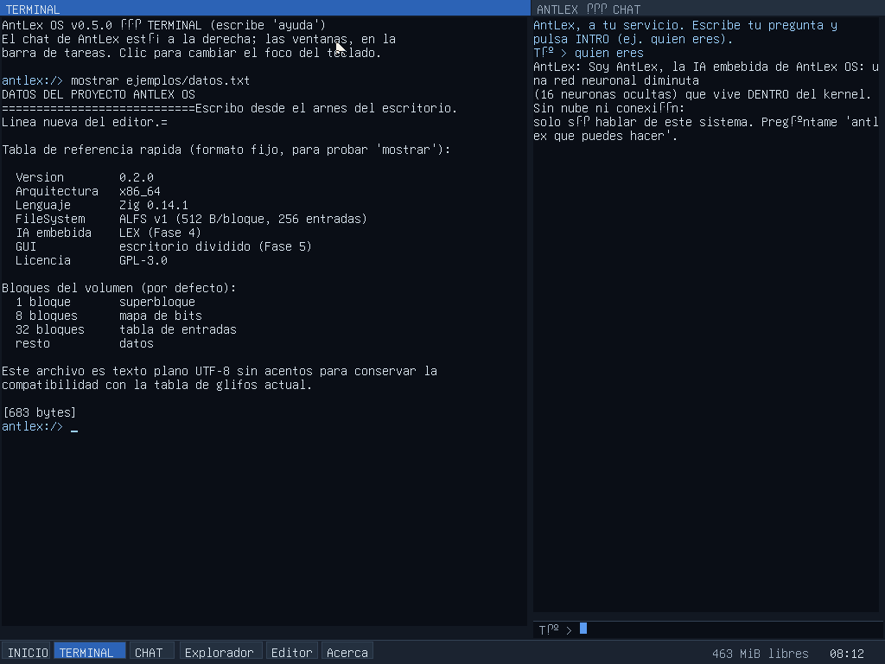
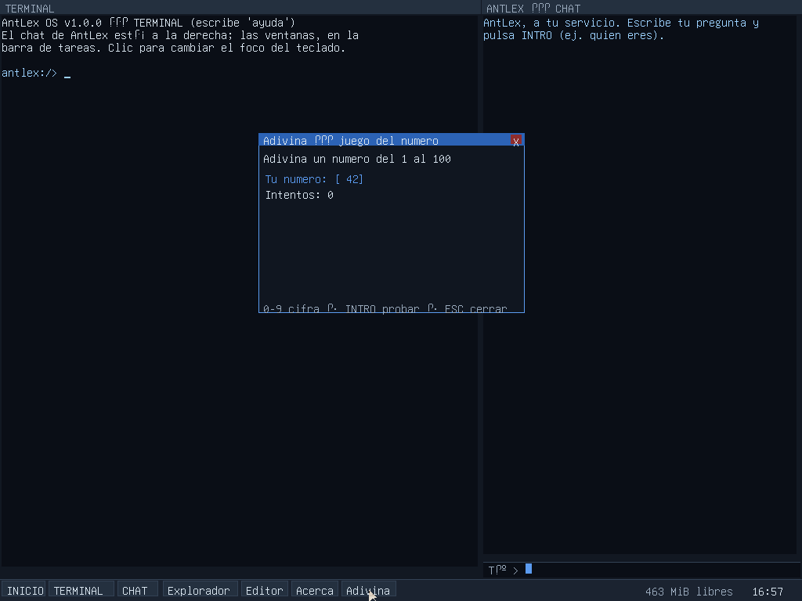

# AntLex OS

**Sistema operativo experimental desde cero en Zig (x86_64) con IA embebida, GUI propia con ventanas y ratón, sistema de archivos propio y arranque en BIOS y UEFI.**

- **Bootloaders 100% propios**: BIOS (MBR + stage2 en ensamblador) **y** UEFI (BOOTX64.EFI en Zig) — ni GRUB ni Limine
- **Kernel en Zig** sin librería C ni runtime: GDT/IDT propias, PIC, PIT, teclado ES/US y ratón PS/2, framebuffer, consola gráfica
- **Escritorio con ventanas**: barra de tareas, foco, arrastre, Explorador, Editor y el juego **Adivina** (Fase 5 + manual de aplicaciones)
- **IA embebida (AntLex)**: red neuronal diminuta entrenada en build-time que solo sabe del propio sistema — panel CHAT o `antlex <pregunta>` en la consola
- **ALFS (AntLex File System)**: sistema de archivos propio con persistencia real en disco
- **Distribución completa**: ISO9660+El Torito que arranca en BIOS y UEFI **sin xorriso**, y portables Linux/Windows con QEMU incluido — descargar y probar sin instalar nada (Fase 6, v1.0.0)



*El escritorio: terminal a la izquierda, chat de AntLex a la derecha, barra de tareas abajo.*



*El juego Adivina — la aplicación de ejemplo del [manual de aplicaciones](docs/manual_aplicaciones.md).*

## Probarlo ahora

**La forma más fácil**: descarga del último [release](../../releases) un **portable**
(`antlexos-vX.Y.Z-portable-linux-x86_64.zip` o `…-windows-x86_64.zip`), descomprímelo
y ejecuta `lanzar.sh` / `lanzar.bat` (o la variante `-uefi`). **No hay que instalar
nada**: lleva QEMU y el firmware dentro.

Con la **ISO** (`antlexos-vX.Y.Z-x86_64.iso`) puedes arrancar en cualquier máquina
virtual o grabarla en un CD/DVD — funciona en BIOS y UEFI:

```bash
qemu-system-x86_64 -cdrom antlexos-vX.Y.Z-x86_64.iso -m 512 -vga std -boot d
```

Con la **imagen de disco** (arranque por BIOS o UEFI):

```bash
# por BIOS (SeaBIOS)
qemu-system-x86_64 -hda antlexos-vX.Y.Z-x86_64.img -m 512 -vga std

# por UEFI (con OVMF instalado)
qemu-system-x86_64 -drive if=pflash,format=raw,readonly=on,file=/usr/share/OVMF/OVMF_CODE_4M.fd \
                    -drive if=pflash,format=raw,file=OVMF_VARS_copia.fd \
                    -hda antlexos-vX.Y.Z-x86_64.img -m 512 -vga std
```

O compila desde fuente (necesitas `zig 0.14.1`, `nasm` y `qemu-system-x86_64`):

```bash
zig build -Drelease=true          # genera antlexos.img y antlexos.iso
zig build test                    # pruebas unitarias en host
zig build probar                  # arranca en QEMU sin interfaz y valida serial+capturas
```

## Estado del proyecto

| Fase | Versión | Contenido | Estado |
|------|---------|-----------|--------|
| 0 | — | Infraestructura, CI, documentación | ✅ |
| 1 | v0.1.0 | Bootloader BIOS + modo gráfico VBE + kernel con consola y autopruebas | ✅ |
| 1b | v0.1.1 | Bootloader UEFI propio (OVMF) | ✅ |
| 2 | v0.2.0 | Sistema de archivos ALFS + driver ATA | ✅ |
| 3 | v0.3.0 | Intérprete de comandos en español | ✅ |
| 4 | v0.4.0 | IA embebida AntLex (red neuronal) | ✅ |
| 5 | v0.5.0 | Escritorio con ventanas, ratón y barra de tareas | ✅ |
| 6 | v1.0.0 | ISO BIOS+UEFI, portables con QEMU, releases automatizados | ✅ |
| — | v1.1.0-dev | Manual de aplicaciones + juego Adivina (primera app de terceros) | 🔨 |

Cada versión queda registrada en [CHANGELOG.md](CHANGELOG.md) y sus pruebas en [docs/PRUEBAS.md](docs/PRUEBAS.md).

## Hacer tus propias aplicaciones

No hay formato de ejecutables independiente (todavía): las aplicaciones son
módulos Zig que se compilan dentro del kernel. El
[**manual de aplicaciones**](docs/manual_aplicaciones.md) explica la
arquitectura, cómo meter datos en el sistema (sin USB ni red), y construye
una app completa paso a paso — el juego Adivina del repositorio es el ejemplo.

## Documentación

- [Manual de usuario](docs/manual_usuario.md)
- [Manual técnico](docs/manual_tecnico.md) — arquitectura, layout de disco, protocolo boot_info, ISO y portables
- [Manual de aplicaciones](docs/manual_aplicaciones.md) — cómo crear apps y juegos para AntLex OS
- [Registro de pruebas](docs/PRUEBAS.md) — cada prueba ligada a su versión
- [Informe de la Fase 4](docs/informe-fase-4-v0.4.0.md) — la IA embebida AntLex, contada en detalle
- [Auditorías de seguridad](docs/revision_seguridad.md)
- [Resumen para continuar el proyecto](docs/RESUMEN_PROYECTO.md) — para otras IA o personas que retomen el trabajo
- [Hoja de ruta](TODO.md)

## Layout del medio de arranque

```
offset      tamaño     contenido
0           512 B      MBR propio (stage1, BIOS)
512         ~8 KiB     stage2 (carga kernel, VBE, E820, modo largo x86_64)
1 MiB       8 MiB      partición 1: FAT16 (EFI/BOOT/BOOTX64.EFI para UEFI)
9 MiB       4 MiB      partición 2: kernel (cabecera "ALKR" + binario crudo)
13 MiB      16 MiB     partición 3: volumen ALFS
```

Todos los offsets son múltiplos de 2048 para que el mismo layout sirva en HDD (512 B/sector) y CD (2048 B/sector; en la ISO el kernel se alinea al sector de 2048 B). La fuente única de verdad es [layout.zig](layout.zig).

## Licencias

- **Código del proyecto**: GPL-3.0 (ver [LICENSE](LICENSE))
- **Glifos de la fuente bitmap**: GNU Unifont (GPL-2+ con excepción de embebido de fuentes) — subconjunto en `assets/unifont_subconjunto.hex` (ver [LICENSES/unifont.txt](LICENSES/unifont.txt))

## Convenciones

- Commits bajo el usuario `juanruiz85` (cuenta propietaria del repo)
- Comandos del sistema **en español** con alias en inglés (`lista`/`ls`, `mostrar`/`cat`, …)
- Versionado semántico; cada tag `vX.Y.Z` dispara un release con binarios (IMG + ISO + portables + fuente + SHA256SUMS)
- Seguridad primero: cada fase pasa una auditoría registrada en `docs/revision_seguridad.md`
